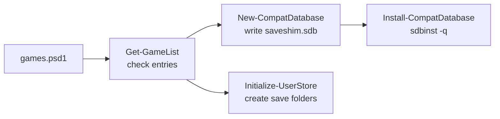

# Design

saveshim is one PowerShell script, `Install-Saveshim.ps1`, that turns a list of games
(`games.psd1`) into a Windows compatibility database and installs it for all users. From then on
Windows itself redirects each game's save folder whenever the game starts; saveshim does not run
again until the list or the users change. The reasons for each choice are in the
[architecture decision records](architecture/decisions/).

`CorrectFilePaths` is one of the compatibility fixes built into Windows, which Microsoft also
calls shims; saveshim is named after them. "The fix" in this page means `CorrectFilePaths`.

## What a run does



1. **Check** (`Get-GameList`). Every entry needs `Name`, `Exe`, `SavePath` and `UserStore`;
   `Name` may hold only letters, digits, `-` and `_`; `UserStore` may use only the placeholders
   below and must use at least one, or every user would share it. Every problem is listed at
   once and nothing changes. `SavePath` can list several places the game may be installed
   in; the first one whose game folder (the one above it) exists is used, and the rest of the
   run sees only that one. A game with no such folder on this PC is skipped with a warning, so
   the shipped list works for someone with only some of its games; if no game is found, the run
   stops. An `Exe` not found near the save folder is only a warning: the search covers the game
   folder, its parent, and the folders directly inside both, which finds GOG's ScummVM layout
   but not every game's.
2. **Write the database** (`New-CompatDatabase`) to `saveshim.sdb` next to the script, through
   the `Sdb*` writer functions exported by Windows' `apphelp.dll`
   ([ADR 3](architecture/decisions/0003-write-the-database-with-apphelp.md)).
3. **Create the save folders** (`Initialize-UserStore`) for every account with a profile folder
   ([ADR 5](architecture/decisions/0005-per-user-stores.md)).
4. **Install** (`Install-CompatDatabase`): uninstall the copy with saveshim's database ID if there
   is one, then `sdbinst -q saveshim.sdb`.

`-WhatIf` prints every step without writing, creating or installing anything. `-StoresOnly` runs
steps 1 and 3 only. `-Uninstall` runs only the uninstall in step 4.

## The database

The database holds one `EXE` entry per exe name
([ADR 4](architecture/decisions/0004-match-by-exe-name-only.md)):

```text
DATABASE
├─ TIME, COMPILER_VERSION "saveshim", OS_PLATFORM 1 (32-bit)
├─ NAME "saveshim: per-user game saves"
├─ DATABASE_ID {6f0d3c52-8a1e-4c47-9b6a-2e5d7f4c1a90}
├─ LIBRARY (empty)
└─ EXE                                  one per exe name
   ├─ NAME "scummvm.exe", APP_NAME "Kyrandia, …", VENDOR "saveshim", EXE_ID (new GUID)
   ├─ MATCHING_FILE NAME "*"            the exe itself, by name only
   └─ SHIM_REF NAME "CorrectFilePaths", COMMAND_LINE "-b …"
```

The tag IDs are those of the shim database format, with the same values as ReactOS's
`sdbtagid.h`. `DATABASE_ID` is fixed, so `sdbinst` treats every run's database as the same one,
and a run replaces the copy installed before it. `OS_PLATFORM 1` limits
the database to 32-bit programs; every tested game is one.

Matching is by exe name only, with no file size, checksum or version
([ADR 4](architecture/decisions/0004-match-by-exe-name-only.md)).

## The CorrectFilePaths parameters

`CorrectFilePaths` rewrites file paths that a program passes to Windows, by prefix, from one path
to another. Its parameters are `-b` (use only the pairs given, none of the fix's built-in ones)
followed by one quoted `"from;to"` pair per game (`Get-FixPair`, `Get-FixCommandLine`):

```text
-b "C:\…\Legend of Kyrandia\DAT\saves;%USERAPPDATA%\ScummVM\Saved games\Kyrandia" "Save\;%USERAPPDATA%\Pharaoh\Saves\\"
```

- **Absolute pairs** are the default: `SavePath` to `UserStore`, both without a trailing `\`.
- **Relative pairs** (`RelativePaths = $true`) are for games that open their saves by a path
  relative to the game folder: Pharaoh asks for `Save\<Dynasty>.dat`, not the full path. The pair
  then maps the last folder name of `SavePath`, with a trailing `\`, to `UserStore` with a trailing
  `\`, so only paths that start with that folder are rewritten.
- **Quoting.** The fix reads its parameters like a command line, where `\"` is an escaped quote,
  so a trailing `\` before the closing quote is written as `\\"`.
- **Placeholders** in `UserStore` stay in the database as written: the fix itself expands
  `%USERPROFILE%`, `%USERNAME%` and `%USERAPPDATA%` for the user running the game.

## User save folders

The fix redirects paths but creates no folders. `Initialize-UserStore` therefore creates each game's
`UserStore` for every account listed in the registry's `ProfileList` with a real-account SID
(`S-1-5-21-…`), an existing profile folder and a SID that still resolves to an account.
`Resolve-UserStore` fills in the placeholders from the profile folder and the account name, the
same way the fix does at run time; `$` in a path or name is kept as it is.

A folder inside the user's profile inherits the user's access. A folder outside it, such as
`D:\savegames\%USERNAME%\Pharaoh`, gets full control for that user's SID through `icacls`.
Existing folders and the saves in them are never changed, moved or deleted.

## Install and uninstall

`sdbinst -q <path>` copies the database into a Windows folder, registers it, with the copy's path
in `DatabasePath`, under
`HKLM\SOFTWARE\Microsoft\Windows NT\CurrentVersion\AppCompatFlags\InstalledSDB\{DATABASE_ID}`,
adds `AppCompatFlags\Custom\<exe name>` for each entry, and lists it in Programs and Features.
`Test-DatabaseInstalled` checks the `InstalledSDB` key.

Uninstall reads the installed copy's path from that key and runs `sdbinst -q -u <path>`, then, if
the key is still there, `sdbinst -q -u -g {DATABASE_ID}`. If both fail, the script stops and
points to Programs and Features.

## Limits

- **32-bit programs only** (`OS_PLATFORM 1`).
- **Any program with a listed exe name** gets the fix, wherever it is installed.
- **Elevated programs:** Windows skips the fix for a game started with "Run as administrator",
  and the game writes to the shared folder; the docs tell users never to do that.
- **No per-user settings:** only the paths listed in `games.psd1` move; other files the game keeps
  in its folder (Pharaoh's `Pharaoh.inf`, ScummVM's `.ini`) stay shared.
- **New accounts** get their folders only when the script runs again after their first login.
